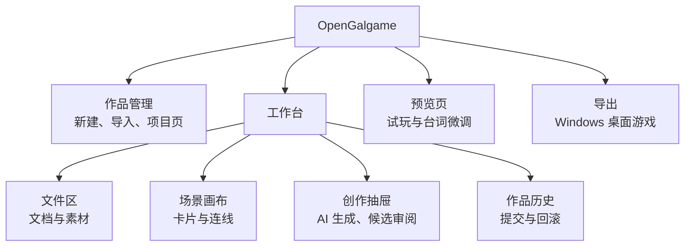

  

<h1 align="center">OpenGalgame</h1>

<strong>画布式编辑 + AI 生成，基于 WebGAL 引擎的 Galgame 创作产品。</strong>

把心动写成可以选择的故事。

  
  
  
  

OpenGalgame 是一个以画布为核心的 AI Galgame（视觉小说）创作产品，本地优先，基于 WebGAL 引擎。你在画布上整理角色、设定、素材和提示词，让 AI 生成 WebGAL 场景；草稿会先以候选形式给你审阅，满意后才进入作品。写完后可以当场试玩，并导出成可以独立运行的 Windows 游戏。

不需要注册账号。作品保存在你自己的文件夹里，AI 请求只发往你配置的模型服务。

## 目录

- [功能](#功能)
- [功能架构](#功能架构)
- [一次完整的创作](#一次完整的创作)
- [分层架构](#分层架构)
- [数据与隐私](#数据与隐私)
- [当前版本](#当前版本)
- [常见问题](#常见问题)
- [技术栈](#技术栈)
- [致谢](#致谢)

## 功能

| 能力       | 说明                                                                       |
| ---------- | -------------------------------------------------------------------------- |
| 作品管理   | 新建空白画布或导入 WebGAL 工程；项目页可打开、重命名、移出列表             |
| 场景画布   | 用卡片整理文档、素材与提示词，连线表达关系；只读文档层、撤销重做、自动保存 |
| 模型连接   | 支持 OpenAI 兼容与 Anthropic 协议；密钥加密存本机，可测试连接              |
| AI 生成    | 在创作抽屉描述场景，AI 必要时先提问，再生成 WebGAL 场景候选                |
| 候选审阅   | 候选先在预览里查看，可修改、重新生成或接受；接受后才写入作品               |
| 试玩与改稿 | 当前场景可直接试玩，台词正文可微调并保存                                   |
| 版本历史   | 每次提交留下记录，可查看作品历史并回滚                                     |
| 导出游戏   | 把当前场景、引用素材与 WebGAL 引擎打包成 Windows 游戏                      |

## 功能架构

OpenGalgame 的界面分成入口、工作台和预览页三块，创作都在工作台里完成；作品文件是唯一权威，AI 只在隔离的候选区写内容，候选经你确认后才进入作品。

模型服务和 WebGAL 引擎在本机之外，由应用按需调用；导出的游戏不再依赖 OpenGalgame。

## 一次完整的创作

1. 在首页新建空白画布，或导入一个已有的 WebGAL 工程。新建会直接进入工作台；导入的作品会出现在项目页，双击打开。
2. 在工作台画布上整理这一场的设定、素材和提示词。画布改动会自动保存。
3. 打开创作抽屉，写清这一场的目标、情绪、出场角色和限制。AI 需要时会问几个选择题；回答后得到场景候选。
4. 打开候选预览。不满意就提修改或重新生成；满意后接受，内容才进入正式作品，并留下版本记录。
5. 试玩当前场景。台词可以直接微调，保存后继续。
6. 导出当前场景，得到一个可以独立运行的 Windows 游戏。

## 分层架构

功能架构里的入口、创作能力和预览，都按下面的分层落到本机数据和外部依赖。OpenGalgame 是模块化的桌面应用，不依赖云端账号或自建服务器。作品以普通文件保存在本地，应用围绕这些文件提供编排、生成、预览和导出。

| 层         | 做什么                                                               |
| ---------- | -------------------------------------------------------------------- |
| 表现层     | 首页、项目页、工作台、预览页，以及画布和交互状态                     |
| 用户接口层 | 把界面请求转成受控的本地调用，做基础校验；不开放任意文件、命令或密钥 |
| 应用层     | 编排新建、导入、生成、提交、预览和导出                               |
| 领域层     | 判断内容能否写入、提交、回滚，以及冲突如何处理                       |
| 基础设施层 | 文件、Git、模型连接、WebGAL 引擎和日志                               |

这些分层对使用者只意味着一件事：界面不会直接改你的文件，AI 也不能绕过你的确认写作品。

Electron 的渲染进程不直接读写磁盘，也不持有模型密钥。本地能力经预加载脚本（preload）暴露的固定接口进入主进程，密钥只保存在本机的加密存储中。作品版本由 Git 保存，但使用时不需要会 Git；提交、历史和回滚都在界面里完成。

## 数据与隐私

- 作品保存在新建时选择的文件夹，项目列表也保存在本机。
- API Key 加密保存在本机，不写入作品、日志或导出包。
- 使用 AI 时，画布上的文字输入、提示词和素材说明会发送到你配置的模型服务；这些内容如何留存取决于该服务。
- 导出的游戏不包含创作工作台、AI 会话和本机设置。

## 当前版本

这是 `0.1.0` 预览版，界面和交互还会调整。下面的能力按当前实现整理。

| 已经可用                                   | 尚未提供                       |
| ------------------------------------------ | ------------------------------ |
| 新建、导入、项目列表、重命名、移出列表     | 多场景和路线装配，整部作品导出 |
| 场景画布、只读文档层、撤销重做、自动保存   | 素材库管理、文稿编辑器         |
| 单场景 AI 生成、提问、候选预览、修改、接受 | 完整的预览编辑                 |
| 当前场景试玩、台词微调、提交历史与回滚     | 网页包和完整发布链路           |
| 当前场景导出 Windows 桌面游戏              | macOS 和 Linux 发行            |

部分桌面端流程还在完善，界面细节也可能变化。

## 常见问题

**支持哪些模型？**

连接设置支持 OpenAI 兼容和 Anthropic 两类协议。只要服务端提供兼容接口，云端服务或本地推理服务都可以填入；具体模型能否使用，取决于服务端是否兼容对应接口。

**导入已有工程会改动原文件吗？**

读取不会写文件。AI 生成在隔离的候选区进行，只有你接受候选后才会提交到作品；提交前可以先预览。

**导出的游戏还需要 OpenGalgame 吗？**

不需要。导出包内含 WebGAL 引擎、当前场景脚本和引用到的素材，可以独立运行。

**把作品移出项目列表会删除文件吗？**

不会。移出只从本机项目列表里去掉登记，磁盘上的工程目录保持原样。

## 技术栈

| 类别           | 选型                                             |
| -------------- | ------------------------------------------------ |
| 桌面           | Electron、electron-vite、electron-builder        |
| 界面           | React、TypeScript、CSS Modules                   |
| 画布           | React Flow（`@xyflow/react`）                    |
| 动效           | GSAP                                             |
| 状态与查询     | Zustand、TanStack Query                          |
| 可访问性与提示 | Radix UI、sonner                                 |
| 校验           | Zod                                              |
| AI 编排        | LangChain、LangGraph                             |
| 作品版本       | isomorphic-git                                   |
| 视觉小说引擎   | WebGAL 4.6.5（`webgal-parser`、`webgal-engine`） |
| 日志           | Pino                                             |
| 测试           | Vitest、Playwright                               |

## 致谢

感谢这些项目提供了关键能力：

- [WebGAL](https://docs.openwebgal.com/)：场景格式、解析器、运行时，以及 Terre 4.6.5 的 Windows 桌面导出模板。
- [isomorphic-git](https://github.com/isomorphic-git/isomorphic-git)：作品版本、提交、历史和回滚。
- [React Flow](https://github.com/xyflow/xyflow)：场景画布的节点、连线和画布交互。
- [GSAP](https://gsap.com/)：页面入场和转场动效。
- [Pino](https://github.com/pinojs/pino)：本机日志。
