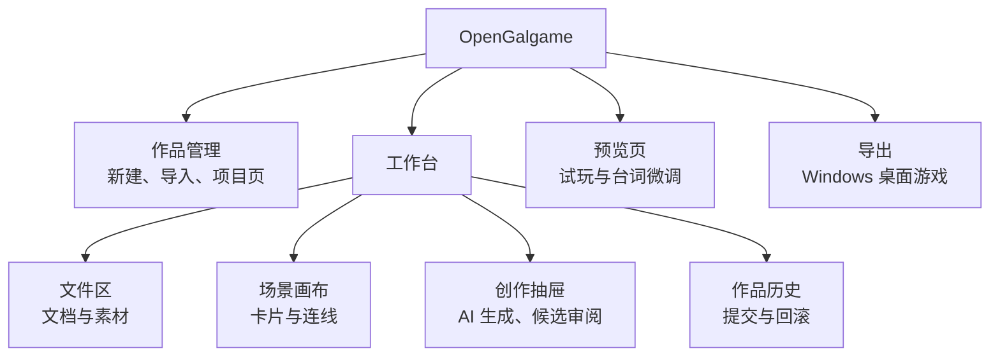

  

<h1 align="center">OpenGalgame</h1>

<strong>画布式编辑 + AI 生成，基于 WebGAL 引擎的 Galgame 创作产品。</strong>

把心动写成可以选择的故事。

  
  
  
  

OpenGalgame 是一款本地优先、基于 WebGAL 引擎的 AI Galgame（视觉小说）创作工具。你可以像摆卡片一样，在画布上整理角色、设定、素材和灵感，让 AI 帮你生成 WebGAL 场景；所有草稿都会先放在候选区等你审阅，满意了再写进正式作品。写完当场就能试玩、微调台词，最后直接打包成独立运行的 Windows 游戏。

不用注册账号，也不用把稿子上传到谁的服务器。作品就存在你自己的文件夹里，AI 请求也只发往你自己配置好的模型服务。

## 目录

- [功能](#功能)
- [功能架构](#功能架构)
- [一次完整的创作](#一次完整的创作)
- [分层架构](#分层架构)
- [当前版本](#当前版本)
- [常见问题](#常见问题)
- [技术栈](#技术栈)
- [致谢](#致谢)
- [关于与许可](#关于与许可)

## 功能

| 能力       | 说明                                                                       |
| ---------- | -------------------------------------------------------------------------- |
| 作品管理   | 新建空白画布，或者导入已有的 WebGAL 工程；在项目页随时打开、重命名或移出列表 |
| 场景画布   | 用卡片整理文档、素材和提示词，连线理清关系；支持只读文档层、撤销重做与自动保存 |
| 应用设置   | 统一设置中心，支持外观与字号、内置字体、OpenAI 兼容 / Anthropic 连接测试与更新检查 |
| AI 生成    | 在创作抽屉里描述想要的场景，AI 拿不准时会先向你提问，再生成 WebGAL 场景候选 |
| 候选审阅   | 候选稿先在预览里查看，不满意可以继续改或重新生成，确认接受后才写入作品       |
| 试玩与改稿 | 当前场景可以直接试玩，发现台词别扭也能当场微调并保存                         |
| 新手引导   | 八步交互式教程，从连接模型到导出成品，直接在界面上标出下一步操作          |
| 版本历史   | 按日期排布的时间线记录，随时翻看作品历史，改坏了一键回滚                    |
| 导出游戏   | 把当前场景、用到的素材和 WebGAL 引擎打包在一起，直接生成可运行的 Windows 游戏 |

## 功能架构

界面主要分成入口、工作台和预览页三块，日常创作基本都在工作台里完成。这里有一个很重要的原则：你的作品文件永远是唯一的主角，AI 只会在隔离的候选区里打草稿，只有你点头确认了，内容才会真正写进作品。

整个过程里，模型请求只发往你配置的服务，WebGAL 也在本机运行；最后导出的游戏完全独立，不再依赖 OpenGalgame。

## 一次完整的创作

1. **定好舞台**：在首页新建一块空白画布，或者导入一个已有的 WebGAL 工程。新建会直接带你进工作台；导入的作品会留在项目页里，双击就能打开。
2. **理清想法**：在工作台的画布上摆好这一场的设定、素材和提示词，画布上的改动会自动帮你存好。
3. **交给 AI 打草稿**：打开创作抽屉，写清楚这一场想讲什么、是什么情绪、有哪些角色出场，以及需要避开哪些雷区。AI 需要确认细节时会先问几个选择题，答完就能拿到场景候选。
4. **审阅与分叉**：打开候选预览看看效果。哪一段不顺眼就直接指出来让它改；如果想留着当前写法、另外试一条新思路，也可以去「AI 历史」里从可分叉的记录接着往下写。只有你亲手接受的候选，才会真正写入作品并留下版本记录。
5. **当场试玩**：直接试玩当前场景，台词有哪里觉得别扭，可以当场微调、保存，然后继续。
6. **打包带走**：导出当前场景，得到一个可以独立运行的 Windows 游戏。

## 分层架构

前面的入口、创作能力和预览体验，底层都按下面的分层落到本机数据和外部依赖上。OpenGalgame 是一个模块化的桌面应用，不靠云端账号，也不搭自建服务器。作品以普通文件的形式存在你本地，应用只是围绕这些文件帮你做编排、生成、预览和导出。

| 层         | 做什么                                                               |
| ---------- | -------------------------------------------------------------------- |
| 表现层     | 首页、项目页、工作台、预览页，以及画布和交互状态                     |
| 用户接口层 | 把界面请求转成受控的本地调用，做基础校验；不开放任意文件、命令或密钥 |
| 应用层     | 编排新建、导入、生成、提交、预览和导出                               |
| 领域层     | 判断内容能否写入、提交、回滚，以及冲突如何处理                       |
| 基础设施层 | 文件、Git、模型连接、WebGAL 引擎和日志                               |

这些分层对使用者来说其实只意味着一件事：界面不会背着你直接改文件，AI 也绝对不能绕过你的确认去动作品。

具体到实现上，Electron 的渲染进程既不直接读写磁盘，也不碰模型密钥。所有本地能力都要通过预加载脚本（preload）暴露的固定接口进入主进程，密钥也只保存在本机的加密存储里。作品版本虽然由 Git 在背后管理，但你完全不需要懂 Git——提交、翻历史、回滚，全部在界面里点一点就能完成。

## 当前版本

目前的 `0.3.0` 版本基于 Pi Agent Core 生成单场景，直接沿用你在设置中心里配好的模型，不用另外折腾账号；同时内置了八步新手引导、应用内更新和统一的外观与连接设置。具体的版本变化可以看[更新日志](docs/更新日志.md)。

| 已经可用                                     | 尚未提供                       |
| -------------------------------------------- | ------------------------------ |
| 新建、导入、项目列表、重命名、移出列表       | 多场景和路线装配，整部作品导出 |
| 场景画布、只读文档层、撤销重做、自动保存     | 素材库管理、文稿编辑器         |
| 单场景 AI 生成、提问、候选预览、修改、接受   | 完整的预览编辑                 |
| 当前场景试玩、台词微调、时间线历史与回滚     | 网页包和完整发布链路           |
| 八步新手引导、外观与内置字体、应用内检查更新 | macOS 和 Linux 发行            |
| 当前场景导出 Windows 桌面游戏                |                                |

## 常见问题

**支持哪些模型？**

连接设置支持 OpenAI 兼容和 Anthropic 两类协议。只要服务端提供兼容接口，无论是云端服务还是本地推理服务都可以填进去；具体某个模型能不能跑通，取决于服务端是否兼容对应接口。

**导入已有工程会改动原文件吗？**

不会。读取工程时不会写任何文件。AI 生成都在隔离的候选区里进行，只有你预览满意并点击接受后，内容才会提交到作品里。

**创建分叉后提示「结果待核对」，要再创建一次吗？**

先去「AI 历史」里点一下「重新核对」。有时候工作台没收到确认回执，但分支其实已经建好了；找到它直接从那里继续就行，不用重复再建一条。

**导出的游戏还需要 OpenGalgame 吗？**

不需要。导出包里已经把 WebGAL 引擎、当前场景脚本和引用到的素材都打在一起了，拿去就能独立运行。

**把作品移出项目列表会删除文件吗？**

不会。移出只是把它从本机的项目列表里去掉，磁盘上的工程文件夹和里面的东西都会原封不动地留着。

## 技术栈

| 类别           | 选型                                             |
| -------------- | ------------------------------------------------ |
| 桌面           | Electron、electron-vite、electron-builder        |
| 界面           | React、TypeScript、CSS Modules                   |
| 画布           | React Flow（`@xyflow/react`）                    |
| 动效           | GSAP                                             |
| 状态与查询     | Zustand、TanStack Query                          |
| 可访问性与提示 | Radix UI、sonner                                 |
| 校验           | Zod                                              |
| 单场景 AI 生成 | Pi Agent Core                                    |
| 作品版本       | isomorphic-git                                   |
| 视觉小说引擎   | WebGAL 4.6.5（`webgal-parser`、`webgal-engine`） |
| 日志           | Pino                                             |
| 测试           | Vitest、Playwright                               |

## 致谢

感谢这些优秀的开源项目提供了关键能力：

- [WebGAL](https://docs.openwebgal.com/)：场景格式、解析器、运行时，以及 Terre 4.6.5 的 Windows 桌面导出模板。
- [isomorphic-git](https://github.com/isomorphic-git/isomorphic-git)：作品版本、提交、历史和回滚。
- [React Flow](https://github.com/xyflow/xyflow)：场景画布的节点、连线和画布交互。
- [GSAP](https://gsap.com/)：页面入场和转场动效。
- [Pino](https://github.com/pinojs/pino)：本机日志。

## 关于与许可

本项目以 [Apache License 2.0](LICENSE) 发布，许可范围与义务以 [LICENSE](LICENSE) 正文为准。

官方构建只通过项目 [GitHub Releases](https://github.com/xinmengqaq/Open-GalGame/releases) 发布。其他渠道的销售、预装、代下载、转载或修改版均属第三方独立发行，与维护者无隶属、代理或背书关系，其更新、支持、收费、安全与合规由发行方自行负责；官方支持仅覆盖官方构建。许可证不授予项目名称、图标或品牌标识的商标权。内置字体按 [SIL Open Font License 1.1](opengalgame/resources/font-licenses/OFL-1.1.txt) 分发，字体版权与保留名称见[字体许可说明](opengalgame/resources/font-licenses/NOTICES.md)。
